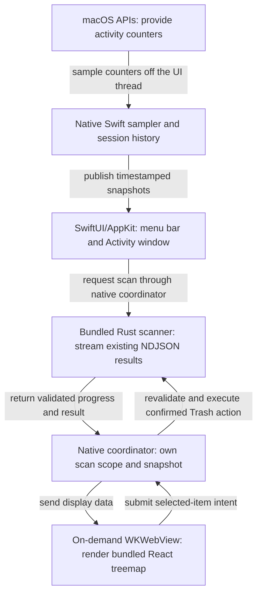

# Pith: a menu bar disk and activity profiler

**Status:** Approved by user · **Updated:** 2026-11-06 (UI revision) · **Name:** Working title

Build a native Mac app that stays in the menu bar, explains current activity, and reuses the existing Rust disk scanner. The default is one compact item showing total CPU usage and memory pressure; recent activity and disk space are one click away.

## Problem and evidence

The user wants `apps/storage` to become a real Mac app with a better Activity Monitor experience. Today it requires a local server and browser. Its Rust scanner and React treemap work, but there is no background sampler or activity history. See the [existing implementation](../../../apps/storage/README.md) and [research report](../../../reports/macOS%20monitor%20app%20research.md).

The original UX complaint was clutter. Adding every available statistic to the menu bar would repeat it. Apple documents that [extras can be hidden when space runs out](https://developer.apple.com/design/human-interface-guidelines/the-menu-bar#Menu-bar-extras). Bjango's [combined-item mode](https://bjango.com/mac/istatmenus/) demonstrates an established way to save space while retaining detailed access.

[Apple distinguishes memory pressure from memory used](https://support.apple.com/guide/activity-monitor/view-memory-usage-actmntr1004/mac): cached files can occupy RAM productively. The headline should describe pressure, not imply that occupied RAM needs cleaning. These sources support the design direction; they do not establish a user-tested winning default.

## Goals

- See CPU activity and memory pressure without opening a window.
- Find the busiest apps and inspect what happened ten minutes earlier during the running session, the retrospective question identified in the research.
- Scan disk space with the existing treemap and safely move selected items to Trash.
- Keep monitoring when windows close, with no Node server or loaded treemap web view on the idle path.

**First-build exclusions:** privileged helper, fan control, automatic cleanup, persisted activity history, and unverified power or temperature readings. Disk activity and disk space share navigation; attributing a particular folder's growth to a particular process requires separate evidence and is not inferred from simultaneous activity.

## Default experience

| Surface | Default |
|---|---|
| Menu bar | One item: the Pith glyph and `12%` CPU (illustrative) in fixed-width digits. The memory-pressure symbol appears, in its status colour, only while pressure is elevated, including in icon-only mode. Stable width, no animated sparkline. |
| One-click panel | CPU and memory pressure over the last ten minutes, the four busiest apps, startup-volume free space, then Activity and Disk. Settings and Quit sit under a ⋯ menu. |
| Activity tab | Searchable app list with CPU, memory, and supported disk read/write rates. A CPU chart ranks apps by any range dragged across it. An inspector shows the selected app's history, processes and actions. |
| Disk tab | Existing treemap, largest files, scan scope, timestamp and skipped-file count. Scans run on request. |

CPU is a share of total machine capacity, consistently labelled across views. Busy CPU is activity, not evidence of a fault. Memory pressure is an OS-reported condition; unavailable or stale data has its own state and must never look healthy. Symbols, accessible labels and panel text distinguish conditions without relying on color.

The panel's interactive graphs and app drill-down justify a window-style menu bar extra, the complexity exception in [Apple's guidance](https://developer.apple.com/design/human-interface-guidelines/the-menu-bar#Menu-bar-extras). Escape and outside-click dismiss it; keyboard and VoiceOver access work throughout. The app also opens from Finder if macOS hides its extra. Closing windows keeps monitoring; Quit ends it. Offer launch at login during setup without enabling it silently. Routine CPU spikes produce no notifications.

## Architecture

**Flow: native background monitoring with an on-demand disk view**

**Native shell, existing scanner boundary.** SwiftUI/AppKit owns lifecycle, metrics and process UI. Bundle the Rust executable and retain its existing versioned NDJSON interface. Native sampling avoids inventing a Rust sampler and foreign-function binding before either is needed. Invoke the executable directly with argument arrays, never shell command strings. Monitoring and scanning have separate cancellation lifecycles.

**A local, disposable disk view.** Extract reusable React components into a static bundle; the TanStack server routes do not ship in the Mac app. Create the WKWebView only for the disk window and release it when closed. Its narrow, validated bridge accepts only bundled content from the main frame; block remote navigation and arbitrary file access. Native code owns scan scope and authorization. Preserve the current containment, protected-path and synthetic-node checks, revalidate at execution, and require confirmation before Trash. Full Disk Access is requested only when relevant; partial scans remain visibly partial.

**Honest sampling.** Use `host_processor_info` tick deltas for total CPU. Probe `kern.memorystatus_vm_pressure_level` for pressure; it is an undocumented sysctl and needs an OS compatibility check. Use `proc_pid_rusage` time, footprint and disk-byte counters where readable, with monotonic elapsed time for rates. Do not claim exact equivalence to Activity Monitor's memory accounting. Unsupported pressure shows an unknown symbol with an explanation; denied process counters show unavailable cells. Neither becomes zero. The prototype must demonstrate these reads on its target OS before enabling them. Power and temperature remain follow-up work.

Local check on 2026-11-05: this Mac runs macOS 26.3; the pressure sysctl returned `1`, and the installed SDK declares the proposed process counters. This establishes presence, not measurement accuracy or compatibility with newer OS versions.

**App identity and history.** Key processes by PID and start time. Group only established helper ownership under an app's bundle identity and launch session; unknown owners remain separate. Record membership with each sample so later ownership changes cannot rewrite history. Aggregate CPU and I/O from those members; label summed process footprints explicitly because shared memory prevents treating their sum as unique physical RAM. Keep timestamped system CPU/pressure and app CPU/footprint/I/O samples for at least ten minutes. A Recent section retains exited apps and their samples for the same interval; raw process detail remains a drill-down. Quitting clears history, and sleep or missed sampling creates a visible gap. Derive cadence and buffer capacity from the prototype's measured cost, including process churn, before setting production limits. The supported first build must pass the ten-minute retrospective test without silently discarding earlier activity.

## UI revision, 2026-11-06

The first build worked but looked like a stock SwiftUI prototype with a Bruhs web page embedded in it: the system accent on every chart, iOS-style big titles, and a visible seam where the disk map began. The revision follows the [Pith UI research](../../../reports/Pith%20UI%20and%20bruhs%20alignment.md) and keeps these hard-to-reverse decisions:

- **System chrome, Bruhs content.** Toolbars, search, tabs, the inspector, the popover and Settings are standard AppKit and SwiftUI. Bruhs supplies colour roles, Monaspace for data, radii and motion inside them. `packages/ui/AGENTS.md` section 18 records the rules for any native app.
- **Follow the system appearance.** Colours come from the semantic roles in `packages/ui/src/lib/semantic.ts`, generated into Swift for light, dark and Increase Contrast. Twelve tokens were pulled inside Display P3 so the generated colours match the CSS.
- **One window with Activity and Disk tabs** (⌘1, ⌘2). The title and subtitle say what the list shows: "Live · last 10 minutes" or "Paused at 10:40:02–10:41:31".
- **Rank by range.** Dragging across the CPU chart freezes the list and ranks apps by their average CPU in that range. Escape or Back to Live returns. This answers the retrospective question without a second history view.
- **A legible disk map.** Blocks under 8 px merge into a "smaller items" block, labels pick the ink that meets 4.5:1 on their fill, and file kinds keep distinct hues.
- **A generated brand.** The bruh-slice app icon (Icon Composer) and menu bar template glyph are generated from the tokens and the shared mascot geometry.

Tripwires keep these true. CI's `check:theme` runs `verify-tokens.mjs`, and `check:pith` runs the Swift token check, `brand.mjs --check` and `lint-native.mjs`. The packaged app's smoke test, run locally, checks fonts, toolbar bridging, range ranking, Escape, tab switching and panel fit. Twenty-four-hour history, launch markers, performance and efficiency core split, and energy remain follow-up work.

## Alternatives and rollout

Tauri offers more direct React reuse but still needs native lifecycle and metrics integration. A fully native treemap removes WebKit but discards working visualization code. Choose the hybrid provisionally; benchmark it on this Mac rather than adopting competitors' footprint claims as a budget. Keep the hybrid only if closing the disk window releases app-owned web resources and CPU/wakeups return to the measured native-only baseline within run-to-run variation. Otherwise resolve the lifecycle issue or replace the disk renderer before release.

Build in small slices: native menu bar and system metrics; process list and session history; read-only scanner/treemap integration; native Trash validation; signed app packaging. Split each slice into independently reviewable changes before implementation. Keep the existing web app usable during migration and defer repository/package renaming. Pith remains a working title pending name checks.

Before release, verify that closing windows stops rendering and releases the web view, sampling pauses during sleep, cancellation stops scan work, restricted data stays explicit, and malicious bridge requests cannot invoke filesystem actions. Record measured idle CPU, wakeups, memory and energy with the app closed, monitoring with windows closed, and the disk view open. Developer ID signing and notarization are release prerequisites; no signing credentials are needed for the local prototype.
